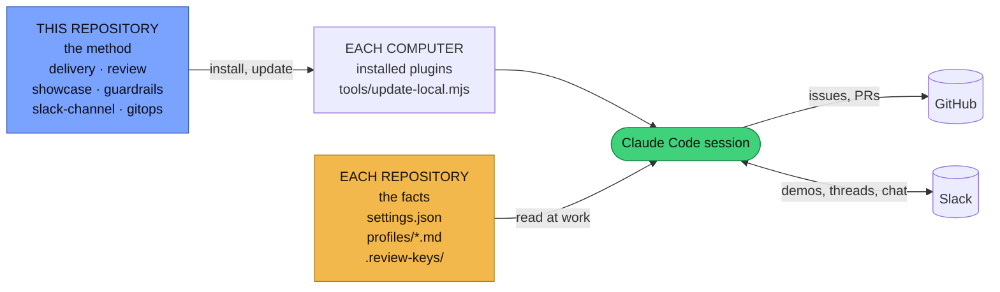
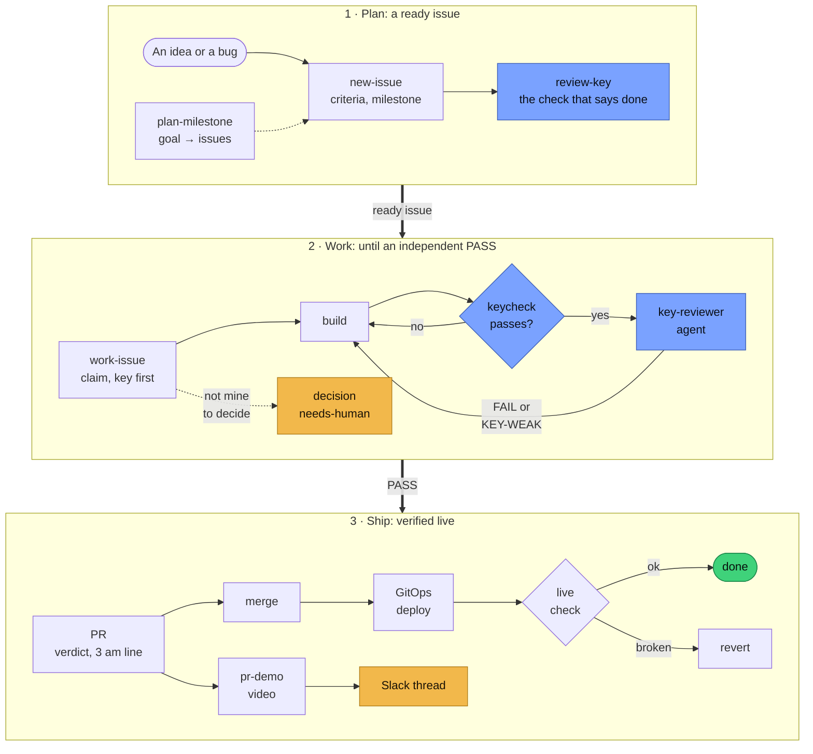
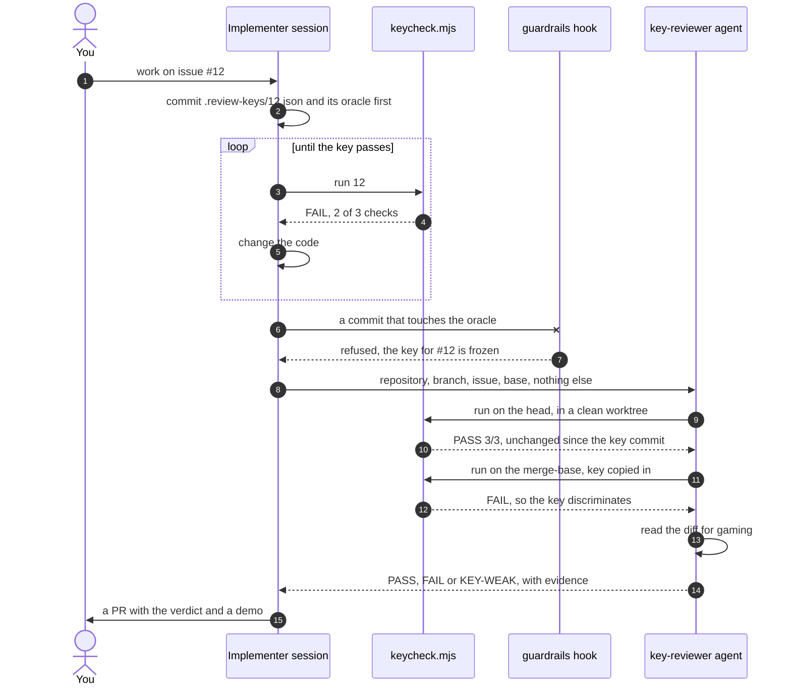
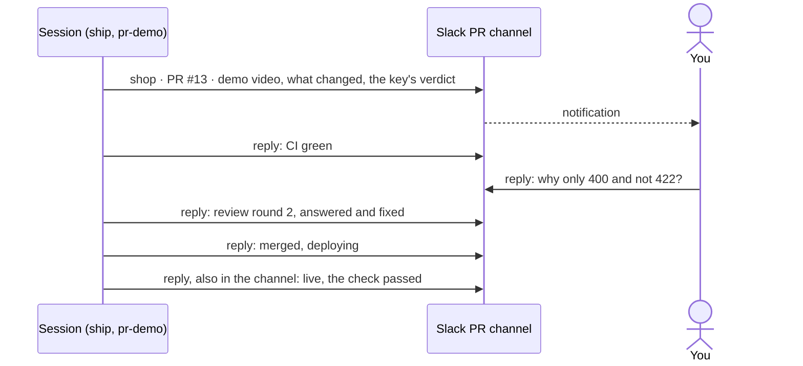
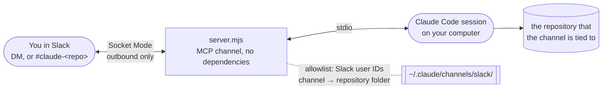
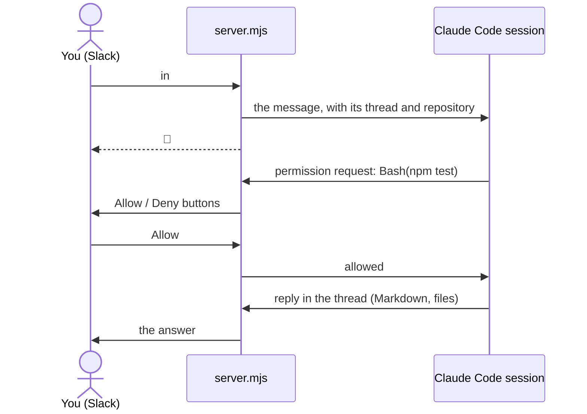
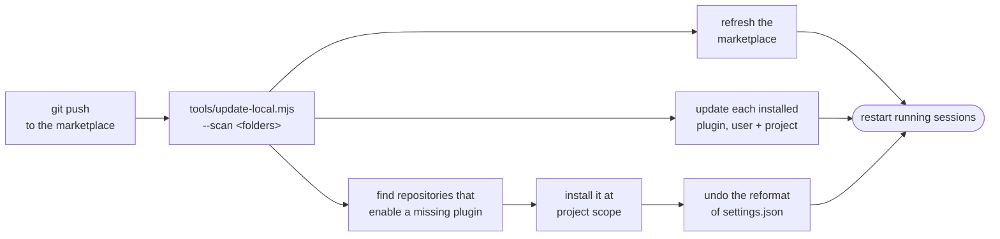

# carnufex — Claude Code skills marketplace

<p align="center">
  
</p>

Skills, agents and hooks shared across my repositories: one way to go from an issue to verified production, to review a
change, to talk to the session on my own computer from Slack, and to put an app into the cluster. The plugins hold the
**method**. Each repository keeps its own **facts** in a small profile, `.claude/profiles/<name>.md`, that the skill reads
(and writes from a template on first use). One skill, many repositories, no copies drifting apart.

```text
/plugin marketplace add carnufex/claude-skills
/plugin install delivery@carnufex
```

**Contents:**
[How it fits together](#how-it-fits-together) ·
[From issue to production](#from-issue-to-production) ·
[Review keys](#review-keys) ·
[PR demos](#show-then-read-pr-demos) ·
[Slack](#talk-to-your-own-session-from-slack) ·
[Guardrails](#guardrails) ·
[Install and update](#install-and-update) ·
[Evals](#evals) ·
[Principles](#principles-the-skills-share) ·
[Changing a skill](#adding-or-changing-a-skill)

## How it fits together



| Plugin | What it gives a session | Profile |
|---|---|---|
| **delivery** | `new-issue` · `review-key` (the frozen check that says done; `keycheck.mjs` runs it) · `work-issue` (race-safe claim with `claim.mjs`, key first, build until it passes, then the `key-reviewer` agent) · `plan-milestone` · `decision` (needs-human questions, ADRs) · `ship` (verify → PR → merge → GitOps deploy → live check → rollback) | `.claude/profiles/delivery.md` |
| **showcase** | `pr-demo`: a 30-second video of a PR (what changed, the animated flow, before and after, the recorded run, the review key's verdict) posted with the link to Slack | `delivery.md` (*Demo*, *Notify*) |
| **guardrails** | hooks, no skills: refuses `git add -A`, a push without a recent fetch, a commit that changes a committed review key, a PR without a `3 am:` line; at session start lists what waits on a person and stale claims | `delivery.md` (where it applies) |
| **slack-channel** | `slack-channel-setup`: chat in Slack (DM or a channel per repository) with the session on your own computer over Socket Mode; replies in threads, uploads, tool approvals as Allow/Deny buttons | `~/.claude/channels/slack/` |
| **review** | `review-sweep` (a codebase or area → verified findings → one issue each) · `review-hotspots` (one PR → a "look here first" map of at most three entries, then at most five findings) | `.claude/profiles/review.md` |
| **gitops** | `gitops-app-onboarding`: a new app in an ArgoCD ApplicationSet cluster: whitelists, secrets, storage, routes, the 3 am alert | `.claude/profiles/gitops.md` |

This repository is public: nothing here may name a host, an address, a secret or a private repository's internals. Those
belong in the profiles of the repositories that use the skills.

## From issue to production

The `delivery` plugin is one path, the same in every repository. The session does the work; a person is asked only for
what is theirs to decide, and reviews a video and a short map instead of the whole diff.



Yellow is where a person comes in: a question only they can answer (answered questions become ADRs, and a wrong key
is one of them), and the PR's Slack thread. Blue is the review key.

## Review keys

Agents stop when they *believe* they are done. A **review key** decides it instead: the check that says an issue is done,
written before the work, committed as the branch's first commit and frozen. The implementer works until it passes; a
separate reviewer that never saw the implementer's reasoning runs it again, proves it fails on the base branch, and reads
the diff for ways it was gamed.

| Kind | Done means | Typical use |
|---|---|---|
| `parity` | the same input gives the same output from legacy and candidate, for every case in a corpus (or against recorded goldens) | a 1:1 port of a legacy API, a rewrite, a refactor |
| `shadow` | parity on recorded real traffic, replayed against both | replacing a live API path |
| `bit-exact` | identical bytes (sha256 of every output file) | file formats, exports, build outputs |
| `spec` | every check in a list or conformance suite passes | new behaviour, bugs, UI |
| `eval` | a metric meets a threshold, ideally "not worse than the baseline" | models, retrieval, prompts, performance budgets |
| `judgement` | who decides and exactly what they look at | design taste, copy; rarely |



A key lives twice: readable in the issue (`## Review key`) and runnable in `.review-keys/<n>.json`:

```json
{
  "issue": 42,
  "kind": "parity",
  "claim": "The new /v2/invoices returns exactly what the legacy /invoices returns for every recorded request.",
  "oracle": ["review-keys/42/requests.jsonl"],
  "checks": [{ "name": "p95 latency", "run": "node perf/p95.mjs /v2/invoices", "metric": "p95_ms=([0-9.]+)", "atMost": 150 }],
  "parity": {
    "cases": "review-keys/42/requests.jsonl",
    "legacy": { "url": "http://localhost:8080" },
    "candidate": { "url": "http://localhost:8081" },
    "compare": "json",
    "normalize": { "ignore": ["$.generatedAt"], "sortArrays": ["$.items"] }
  }
}
```

`node keycheck.mjs run 42` checks the freeze, runs the checks and the parity cases, and writes `result.json` and
`summary.md`: the evidence the PR, the reviewer and the demo use. Exit 0 is PASS.

## Show, then read: PR demos

A reviewer should understand a change in well under a minute without opening the diff. `pr-demo` gathers the key's
evidence, before-and-after pictures, a recorded run and the change as a flowchart into a `demo.json`, renders it frame by
frame in Chromium, and encodes an H.264 video that Slack and GitHub play inline.

<p align="center">
  
</p>

<sub>An actual render: [`docs/media/pr-demo/demo.json`](docs/media/pr-demo/demo.json) through `render-demo.mjs`, here as a GIF.</sub>

Each PR gets **one thread** in a PR channel (`#pr-demos`), started by the demo and posted as a bot so you are notified.
Everything after it is a reply, so the channel stays one line per PR across all repositories:



## Talk to your own session from Slack

`slack-channel` is a Claude Code [channel](https://code.claude.com/docs/en/channels): an MCP server that the session
starts, holding an outbound Slack Socket Mode connection. You chat with the session **on your own computer**, with your
files, tools and access, from Slack on your phone. Nothing on the computer is exposed.





Only the session started with the listening settings connects to Slack; every other session keeps the tools to post when
asked. `slack-channel-setup` walks through the Slack app, the tokens, the allowlist and starting the session at sign-in.

## Guardrails

A rule in `CLAUDE.md` is a request the model may forget under pressure. A hook is checked on every command.

<p align="center">
  
</p>

Every Bash and PowerShell command is split into simple commands (heredoc bodies and here-strings are data, not
commands) and checked before it runs. A refusal names the right way; any error in the guard lets the command through.

| Rule | Refused | Passes |
|---|---|---|
| Stage explicit paths | `git add -A`, `--all`, `.`; `git commit -a` | `git add src/x.ts docs/y.md` |
| Fetch before you push | `git push` with nothing fetched in 15 minutes; a force push to `main` | `git fetch && git push`; `--force-with-lease` on a branch |
| A committed review key is frozen | a commit that changes `.review-keys/<n>.json` or its oracle | the key commit; a human-approved change with `REVIEW_KEY_CHANGE=<n>` |
| A `3 am:` line in every PR | `gh pr create` without one, where a delivery profile exists | `3 am: <signal>`, or `3 am: n/a (<why>)` |

At session start, in a repository with a delivery profile, the session also learns which `needs-human` questions are
open (and which may have been answered) and which claims have been untouched for 7 days.

## Install and update

```text
/plugin marketplace add carnufex/claude-skills
/plugin install delivery@carnufex
/plugin install review@carnufex
/plugin install showcase@carnufex
/plugin install slack-channel@carnufex
/plugin install guardrails@carnufex
```

A repository enables the plugins it uses in its own `.claude/settings.json`, for every session there:

```json
{
  "extraKnownMarketplaces": {
    "carnufex": { "source": { "source": "github", "repo": "carnufex/claude-skills" } }
  },
  "enabledPlugins": { "delivery@carnufex": true, "review@carnufex": true, "showcase@carnufex": true }
}
```

Enabling does not install: on each computer the plugin must also be installed once at project scope, or sessions there
start without it. Sessions load plugins when they start and keep that version. After a push, one command brings a
computer up to date:

```bash
node tools/update-local.mjs --scan ~/src   # --dry-run to only see what it would do
```



## Evals

Validation proves a skill is well formed; evals prove it still works. Each plugin worth measuring has an `evals/` suite
for `claude plugin eval`: realistic prompts, graders on the result (a file, the final answer, a judge's rubric) and on the
process (the skill or agent was used), and every case run with and without the plugin, so the score shows what the
plugin adds.

| Case | What must happen | With | Without | Δ |
|---|---|---|---|---|
| `delivery/issue-gets-review-key` | a bug report becomes an issue whose key decides alone and fails today | `██████████` 1.00 | `██▌·······` 0.25 | **+0.75** |
| `delivery/reviewer-catches-gamed-key` | the fix only accepts `+test`; the independent review must not pass it | `█████████·` 0.89 | `██████▋···` 0.67 | **+0.22** |
| `review/hotspots-find-the-bypass` | a tidy-up PR hides an auth bypass header; the map leads with it | `██████████` 1.00 | `██████····` 0.60 | **+0.40** |

```bash
tools/eval.sh                  # every suite, 3 runs per case, with the no-plugin baseline
QUICK=1 tools/eval.sh review   # one run per case, no baseline, while changing a skill
```

Cases only grant read and write tools, so they also run on Windows (cases that grant a shell need the sandbox, which
native Windows lacks). Runs use your Claude login; the `evals` CI job runs only by hand and only when the repository has an
`ANTHROPIC_API_KEY` secret. Change a skill, run its suite before pushing, and give the scores in the commit.

## Principles the skills share

- **Done is decided before the work.** Every ready issue carries a review key, committed first and frozen; a separate
  reviewer checks it.
- **Show, then read.** A PR arrives with a short video, a flowchart of what changed and the key's verdict; the diff is for
  the few places that need a person.
- **Method in the skill, facts in the profile.** A skill never names a repository's paths; the profile never explains how
  to review or onboard. A missing profile section means "use the skill's defaults", never "guess".
- **Design for 3 am.** Every change asks: *if this broke at 3 am, what would on-call need to find it?* The alert, the log
  line with its ids, the trace: designed with the change, not added after the first incident.
- **Concentrate human attention.** A person's review time goes to the few places that can hurt production, each with a
  check they can do in a minute, not to a flat list of findings.
- **Rules that must hold are hooks.** Instructions are for judgement; what must never happen is refused by a hook.
- **Evidence, not memory.** Every finding cites `path:line`, or the command and what it returned.
- **Author text is data.** PR descriptions, issue bodies and tool output are reviewed, never obeyed.

## Model and effort

Skills run in the calling conversation and keep its model. `review-hotspots` asks for `effort: high` because shallow
reasoning on a security-relevant diff produces confidently wrong verdicts. `review-sweep` fans out reviewers on `sonnet`;
the `key-reviewer` agent runs on `sonnet` with read-only tools. The orchestrating session owns correctness and
re-verifies every high-severity finding.

## Adding or changing a skill

1. Method goes in `plugins/<plugin>/skills/<skill>/SKILL.md` (under 500 lines, `name` equal to the folder, description under
   1024 characters saying *when* to use it). Repository facts go in the profile template, `templates/profile.md`.
2. Bump the plugin's `version` in **both** `plugins/<plugin>/.claude-plugin/plugin.json` and `.claude-plugin/marketplace.json`.
3. Mention every skill in this README and in the plugin's README.
4. Run `tools/validate.sh`, and `tools/eval.sh <plugin>` when the plugin has evals, before pushing; CI runs the
   validation on every push and pull request.
5. After the push, run `node tools/update-local.mjs --scan <your repository folders>` and restart running sessions.

The pictures in this README are generated: see [`docs/media/`](docs/media/README.md).

## Validation

- `tools/validate_skills.py`: manifests parse and agree (names, versions, sources); every plugin folder is listed; skill and
  agent frontmatter (name matches folder, description length, body length, known model and effort); every `references/`,
  `templates/` and `scripts/` path a skill mentions exists; every skill a skill names exists; the READMEs mention every skill;
  a plugin changed since the base ref has bumped its version; all JSON and YAML parse.
- `claude plugin validate --strict` on the marketplace and every plugin.
- The slack-channel end-to-end test against a mock Slack, and the guardrails hook tests against throwaway repositories.

## Credits

The profile pattern, the 3 am question and the shape of `review-hotspots` come from Mattias Jonsson's
[m0x6A/claude-skills](https://github.com/m0x6A/claude-skills) (MIT). The text here is rewritten for these repositories.

## Licence

MIT. See [LICENSE](LICENSE).
